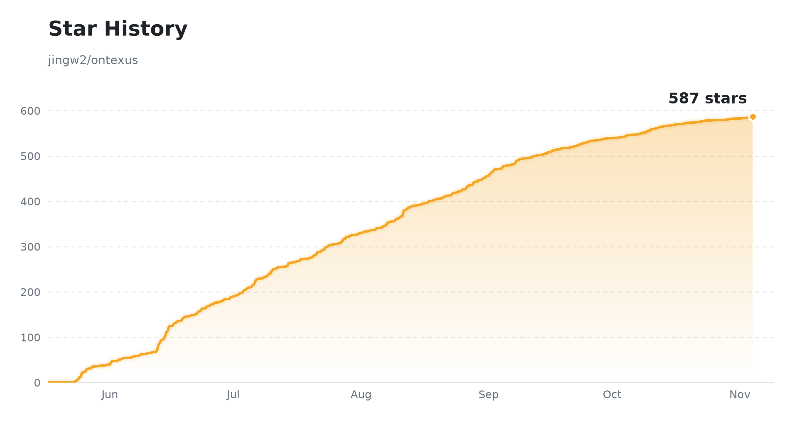

# Ontexus

**[中文文档](./README_zh.md)**

A lightweight, Palantir Foundry-inspired platform for building domain ontologies from raw data. Connect your data sources, run them through a visual transform pipeline, map curated datasets to entity types, and explore the resulting knowledge graph — complete with entities, relations, logic rules, and executable actions.

## Why "Ontexus"?

**Ontexus = Ontology + Nexus.**

- **Ont-/Onto-** → Ontology — the business-semantic model: entities, relations, rules, actions
- **Nexus** → a connection point, a hub, the place where things converge

Ontexus isn't just a knowledge-graph tool. The Ontology is the middle layer between an Agent and an enterprise's real business world:

```
Data / Knowledge → Ontology → Context → Logic / Actions → Agent
```

The "nexus" isn't about the graph itself — it's about the connections: business objects, relations, rules, actions, context, and Agents, all meeting at one semantic layer.

**Ontexus = the Ontology Nexus for enterprise Agents.**

What we want to do is Enterprise Domain-Level Agent Infra. 

---

Two build paths are supported:

- **Pipeline Mapping** (v2) — full data-integration chain: `Data Connection → Raw Storage → Transform → Curated Dataset → Ontology Mapping`
- **Simple LLM Extraction** (v1) — upload documents, pick a prompt and model, and extract a knowledge graph in one shot

---

## What is an Ontology?

An ontology is a formal representation of knowledge in a specific domain — a shared vocabulary of concepts and the relationships between them. Think of it as the structured backbone that turns raw data into machine-readable, queryable knowledge.

In Ontexus, every ontology is made of these building blocks:

| Building Block | What it captures | Example |
|---|---|---|
| **Entity (Object Type)** | A key concept mapped from a curated dataset, one node per data row | `Supplier`, `PurchaseOrder` |
| **Relation (Link Type)** | An edge between entities, inferred from foreign keys and cross-dataset value overlap | `PurchaseOrder -[HAS_SUPPLIER]-> Supplier` |
| **Logic Rule** | The rule layer: mapping / validation / state / inference / automation rules discovered from schema, quality reports and relations | `amount > 0`, state machine on `库存状态` |
| **Action** | The executable behavior layer: CRUD, state-transition and link actions generated from object types and relations, with submission criteria and audit snapshots | `Approve Record`, `Link Order to Supplier` |

**Typical use cases:** supply chain modeling, clinical concept extraction, financial compliance, legal document structuring — any domain where you need to turn heterogeneous data into structured knowledge.

---

## Features

### Pipelines (v2)
- **Visual pipeline builder** — connector / storage / transform / output nodes on a canvas, with per-node status and data preview
- **Three transform routes** — A: structured (CSV/Excel, schema inference + cleansing), B: semi-structured (JSON flatten / XML parse), C: unstructured (document → Markdown → LLM or rule-based structured extraction)
- **Connectors** — file upload, MySQL/PostgreSQL, MongoDB, REST API (with incremental sync)
- **Curated datasets** — quality scoring, human review (admin approval), versioning

### Ontology (v2)
- **Auto mapping engine** — dataset → entity type, column → property, FK → link type, with cardinality inference
- **Cross-dataset link inference** — exact FK matching, value normalization (`SUP-001` ↔ `SUP001`), alternate-key matching (e.g. document mentions of company names linking to Supplier entities), optional LLM-assisted semantic linking (`ENABLE_LLM_FK_DETECTION=1`)
- **Logic & Action discovery** — rules and actions are discovered from mappings, schema constraints, state fields and relations, then go through draft → review → publish
- **Knowledge graph** — interactive Cytoscape.js mesh view with isolated-node toggle; Neo4j-backed when available, SQLite fallback otherwise
- **Search** — keyword search (SQL fallback when ChromaDB is down) and semantic search (ChromaDB)

### Quality Audit (ReAct Agent)
- **LLM-driven multi-step review** — an AI agent systematically checks ontology quality: isolated entities, broken references, missing relations, low-coverage entity types
- **Tool-calling architecture** — 8 built-in inspection tools (summary, coverage, ref-check, pattern inference) that the agent can chain together
- **Findings report** — severity-classified issues with actionable fix suggestions, persisted as audit tasks

### Agent Execution (runtime)
- **Conversational Agent application** — sessions, reliable SSE streaming with reconnect/replay, clarification, and action approval flows
- **Ontology-grounded tool access** — released-ontology index, run/data grants, and observable lineage citations (no chain-of-thought)
- **Reconciliation** — when a tool/action execution's outcome is unknown (lost result, lost fence, unknown result), an admin confirms the external side effect as succeeded / not-run / retry from evidence. Never auto-replays. See [Agent Reconciliation Guide](./docs/agent-reconciliation.md) for a bilingual usage walkthrough.

### Platform
- **LLM extraction** — any OpenAI, Anthropic, or OpenAI-compatible model; defense-in-depth against fuzzy relation types
- **LiteLLM proxy** — optional LiteLLM integration for unified API-key management and cost tracking across multiple LLM providers
- **Prompt management** — versioned domain prompts with one-click template generation
- **Data management** — structured data browser with curated dataset detail panel, row-level editing, and review workflow
- **Export** — JSON, YAML, CSV, Turtle (RDF), HTML
- **Graceful degradation** — Neo4j / MinIO / ChromaDB / Redis are all optional; the system falls back to SQLite + local file storage + synchronous runs
- **Multi-language UI** — English / Chinese toggle
- **User management** — JWT auth, admin/editor roles; curated approval is admin-only

---

## Tech Stack

| Layer | Technology |
|---|---|
| Frontend | React 19, TypeScript, Vite, Tailwind CSS, Cytoscape.js |
| Backend | FastAPI, SQLAlchemy, Alembic |
| Metadata DB | SQLite (dev) / PostgreSQL (prod) |
| Object storage | MinIO (optional, local-file fallback) |
| Graph DB | Neo4j (optional, SQLite fallback) |
| Vector DB | ChromaDB (optional) |
| Task queue | Celery + Redis (optional, synchronous fallback) |
| LLM clients | OpenAI SDK, Anthropic SDK |
| LLM proxy | LiteLLM (optional) |

---

## Architecture Guide

For a deep dive into the Ontology-as-a-Service architecture — including Object/Link/Function/Governance design patterns, multi-tenant isolation, clinical screening workflows, and production deployment checklists — see **[ONTOLOGY.md](./ONTOLOGY.md)** (2727 lines, in Chinese).

---

## Quick Start

### Option 1 — Docker Compose (full v2 stack)

```bash
git clone https://github.com/jingw2/ontexus.git
cd ontexus
cp .env.example .env          # edit secrets before production use
docker compose -f docker-compose.v2.yml up --build
```

This starts PostgreSQL, Redis, Neo4j, MinIO, ChromaDB, backend and frontend.
A dedicated `migration` service runs `run_migrations.py upgrade head` against
an empty database first; backend/worker services wait for it to complete
successfully (Compose `service_completed_successfully`) before starting.

Open [http://localhost:5173](http://localhost:5173). Default credentials: `admin / admin123`.

### Option 2 — Manual setup (minimal, no external services)

**Prerequisites:** Python 3.11 or 3.12, Node 22.14.0, npm 11.2.0

```bash
# Backend
cd backend
python -m venv .venv && source .venv/bin/activate   # Windows: .venv\Scripts\activate
python scripts/bootstrap_backend.py
python scripts/run_migrations.py upgrade head
uvicorn app.main:app --reload --port 8000

# Frontend (separate terminal)
cd frontend
npm install
npm run dev
```

Neo4j / MinIO / ChromaDB / Redis are optional — without them the app uses SQLite graph fallback, local file storage and synchronous pipeline runs.

### Release gate (local)

The governed Runtime gate is deterministic and makes no model calls. Run it
from the repository root after starting the disposable PostgreSQL/Redis stack:

```bash
python test_data/runtime/generate_runtime_fixtures.py --seed 20260826 --output test_data/runtime --check
cd backend && python -m pytest tests/runtime/test_acceptance_matrix.py tests/runtime/test_registered_case_execution.py -q
cd backend && python -m tests.runtime.run_registered_cases --manifest ../test_data/runtime/manifest.json --report ../artifacts/runtime/deterministic-cases.json
cd .. && python -m pip install -e sdk && cd sdk && python -m pytest tests -q
```

For the live refresh checkpoint, run `bash scripts/verify_refresh_checkpoint.sh`.
It alone owns the Compose refresh profile, synthetic seeding, signed webhook,
and polling flow; do not duplicate those steps in another local script. The
main CI gate also validates both application Compose files and the queue-bound
Celery worker topology. Browser governance coverage is `cd frontend && npx
playwright test src/test/e2e/runtime-governance.spec.ts`; it requires the
services configured by that suite and must not be represented as a model test.

### Real business-journey gate (CI only)

`business-journey-real-gate` in `.github/workflows/agent-mvp.yml` is a
blocking, trusted-pull-request-only job that exercises the three enterprise
journeys (supply chain, finance, credit) against a real DeepSeek model and
the real Agent-creation browser flow — see
`test_data/runtime/README.md#the-real-gate-task-5` and
`scripts/run_business_journey_gate.sh` for the exact phase order. It requires
the repository secret `DEEPSEEK_API_KEY` and never runs on `pull_request_target`
or a fork; only sanitized, scanner-approved evidence is ever uploaded. This
gate needs a live key and a disposable Compose stack, so it cannot be run
from a plain local checkout the way the release gate above can.

---

## Usage (Pipeline Mapping path)

1. **Add a model** — *Models → Add Model*: provider, API key, base URL. Tag usage (extraction / VLM / FK detection).
2. **Create a pipeline** — *Pipelines → New*: drop connector / storage / transform / output nodes on the canvas, attach your data file, pick a transform route, then **Run**.
3. **Review curated data** — *Pipelines → Curated*: inspect quality score and preview, then approve (admin).
4. **Create an ontology** — *Ontologies → New*, build mode **Pipeline Mapping**: select approved curated datasets and map each to an entity type with a primary key.
5. **Build** — relations are inferred across datasets automatically; logic rules and actions are discovered as drafts.
6. **Explore** — *Graph* tab for the mesh view, *Entities / Logic / Actions* tabs for details and review, then publish logic/actions.
7. **Export** — JSON, YAML, CSV, Turtle (RDF), or HTML from the *Info* tab.

For the **Simple LLM Extraction** path: create an ontology in `simple_llm` mode, upload documents in the *Files* tab, pick a prompt + model, and run extraction.

---

## Project Structure

```
ontexus/
├── backend/
│   ├── alembic/               # DB migrations (0001_full_baseline covers all tables)
│   ├── app/
│   │   ├── routers/           # v1 + v2 REST API endpoints
│   │   ├── models/            # SQLAlchemy ORM models (v1 + v2)
│   │   ├── services/
│   │   │   ├── connection/    # File / SQL / Mongo / REST connectors
│   │   │   └── v2/
│   │   │       ├── pipeline/  # Transform engine, routes A/B/C, steps
│   │   │       ├── mapping/   # Auto mapper, FK & alternate-key link inference
│   │   │       ├── graph/     # Neo4j service, Cypher validation, analytics
│   │   │       ├── curated/   # Quality scoring, review workflow
│   │   │       └── vector/    # ChromaDB service
│   │   └── tasks/             # Celery tasks (pipeline run, sync, extraction)
│   ├── scripts/               # Maintenance scripts (orphan data cleanup, migration)
│   └── tests/                 # 300+ pytest cases
├── frontend/
│   ├── scripts/                # One-off debug / demo / test scripts
│   └── src/
│       ├── pages/pipelines/    # Pipeline list + canvas builder
│       ├── pages/ontologies/   # Ontology detail: graph / entities / logic / actions / audit
│       ├── pages/data-management/  # Structured data browser + curated detail panel
│       └── api/                # Axios clients (v1 + v2)
├── scripts/
│   └── data/                   # Data import & entity-linking scripts (SNOMED, supply chain)
├── docker-compose.v2.yml       # Full stack: Postgres + Redis + Neo4j + MinIO + Chroma
├── litellm_config.yaml         # LiteLLM proxy configuration
├── ONTOLOGY.md                 # Comprehensive architecture guide
└── test_data/                  # Sample datasets and E2E acceptance scripts
```

---

## Environment Variables

See `.env.example` for the full list. Key settings:

```env
ENVIRONMENT=development        # "production" enforces non-default secrets at startup
DATABASE_URL=sqlite:///./ontexus.db
SECRET_KEY=change-me
ENCRYPTION_KEY=                # Fernet key for encrypting stored API keys
FIRST_ADMIN_USER=admin
FIRST_ADMIN_PASSWORD=admin123

# Optional services (graceful fallback when absent)
REDIS_URL=redis://localhost:6379/0
NEO4J_URI=bolt://localhost:7687
MINIO_ENDPOINT=localhost:9000
CHROMA_HOST=localhost

# Upload limits
MAX_UPLOAD_MB=200
ALLOWED_UPLOAD_EXTENSIONS=csv,xlsx,xls,json,xml,pdf,docx,doc,pptx,ppt,md,txt

# Optional: LLM-assisted semantic FK detection (needs a configured model)
ENABLE_LLM_FK_DETECTION=0
```

---

## Troubleshooting

**Login fails with `AggregateError [ECONNREFUSED]` in the frontend container.**
Pull the latest code — the Vite proxy now targets `http://backend:8000` inside Docker via `VITE_API_PROXY_TARGET`. Then rebuild: `docker compose up -d --build frontend`.

**Cannot login with `admin / admin123` on an existing deployment.**
The admin user was seeded with the old default password. Reset it:

```bash
# Docker
docker compose exec backend python scripts/reset_admin_password.py

# Manual setup
cd backend && python scripts/reset_admin_password.py
```

Options: `--user <username>` (default `admin`), `--password <new_pwd>` (default `admin123`).

**LLM extraction OOM-killed (macOS / low-memory environments).**
Parallel extraction with multiple LLM calls can exhaust memory on machines with limited RAM. The code now defaults to serial extraction (`max_workers=1`). If you still hit issues, extract one domain at a time, or reduce the number of uploaded files per ontology.

---

## Star History

<picture>
  <source media="(prefers-color-scheme: dark)" srcset="assets/star-history-dark.png" />
  <source media="(prefers-color-scheme: light)" srcset="assets/star-history-light.png" />
  
</picture>

<sub>Generated by [`scripts/gen_star_history.py`](scripts/gen_star_history.py) via [GitHub Actions](.github/workflows/star-history.yml), updated daily</sub>

---

## License

[PolyForm Noncommercial License 1.0.0](LICENSE) — free for noncommercial use (personal, research, education, nonprofit/government). Commercial use requires a separate license from the copyright holder.
